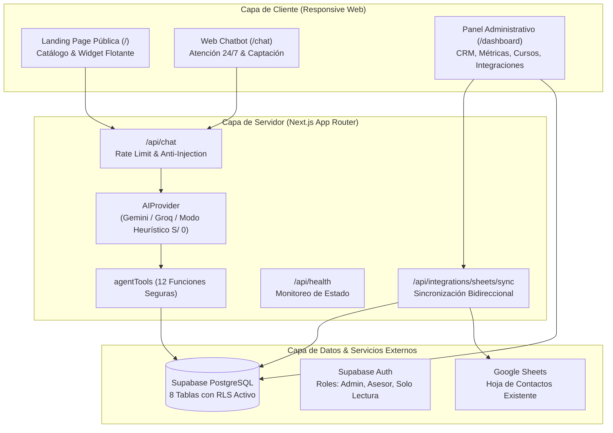

# ARQUITECTURA DEL SISTEMA: JANM ELITE AI

**Empresa:** ORATORIA JANM ELITE  
**Producto:** JANM ELITE AI  
**Tecnologías:** Next.js (App Router), TypeScript, Tailwind CSS, Supabase PostgreSQL, Supabase Auth, Google Sheets API.  
**Presupuesto Objetivo:** S/ 0 (Costo cero permanente en tiers gratuitos y open-source).

---

## 1. Visión General de la Arquitectura

---

## 2. Principios de Diseño
1. **Desacoplamiento Estricto:** La lógica de negocio no depende de un proveedor de IA propietario. Si no hay conexión o API keys, el sistema conmuta automáticamente al **Modo Heurístico Sin IA**, respondiendo consultas oficiales, buscando cursos, captando datos y transfiriendo a WhatsApp sin costo.
2. **Defensa en Profundidad (Zero Trust):** Todas las tablas cuentan con Row Level Security (RLS) habilitado. Las consultas y escrituras se validan en el servidor; el cliente jamás recibe la clave `service_role`.
3. **No Invocación de Modelos Pesados en Vercel:** Para no exceder los límites de tiempo de ejecución de las Serverless Functions de Vercel (10 segundos en Hobby / 15 en Pro), las llamadas a modelos son ligeras vía API o ejecutadas por el motor de reglas en memoria.
4. **Protección de Datos Personales (Perú Ley N° 29733):** Minimización de datos en respuestas públicas, aviso de privacidad visible, y mecanismo de revocación y baja inmediata con la palabra clave `BAJA`.
