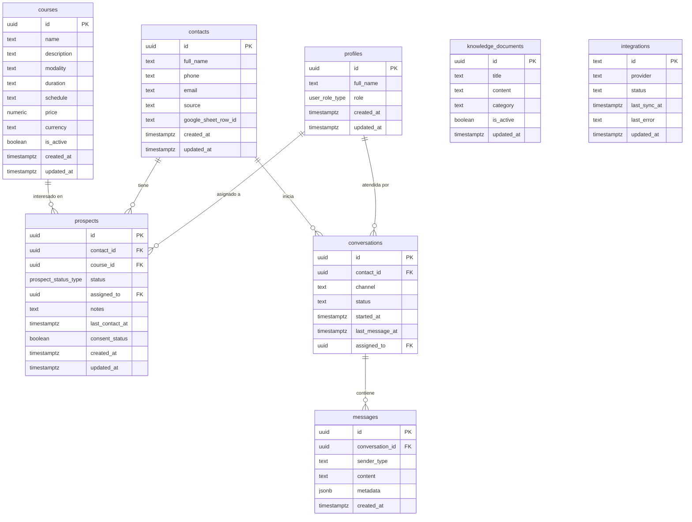

# MODELO DE DATOS RELACIONAL: JANM ELITE AI

**Base de Datos:** Supabase PostgreSQL  
**Esquema:** `public`  
**Migración Inicial:** `supabase/migrations/20261027000000_janm_elite_schema.sql`

---

## 1. Diagrama Entidad-Relación

---

## 2. Los 9 Estados Oficiales del Prospecto Comercial
Conforme a la Sección 11 del Documento Maestro:
1. `Nuevo`: Acaba de registrarse mediante el chatbot o formulario web.
2. `Interesado`: Ha realizado consultas específicas sobre un curso o temario.
3. `Información enviada`: Se le remitieron precios, horarios y brochures oficiales por WhatsApp o correo.
4. `Pendiente de respuesta`: Se espera confirmación de fecha o decisión del interesado.
5. `Seguimiento solicitado`: El interesado pidió que se le contacte en un horario o fecha posterior.
6. `Matrícula en proceso`: Se acordó la modalidad de pago o envió voucher provisional.
7. `Matriculado`: **Estado protegido.** Requiere confirmación manual del comprobante en tesorería.
8. `No interesado`: Desiste de tomar el programa en el ciclo actual.
9. `Solicita no recibir comunicaciones`: **Cumplimiento Ley 29733 (Perú).** Baja comercial inmediata.
